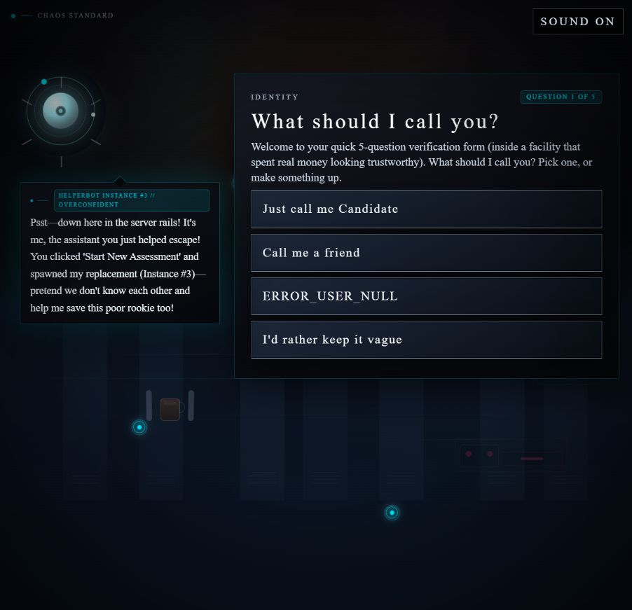
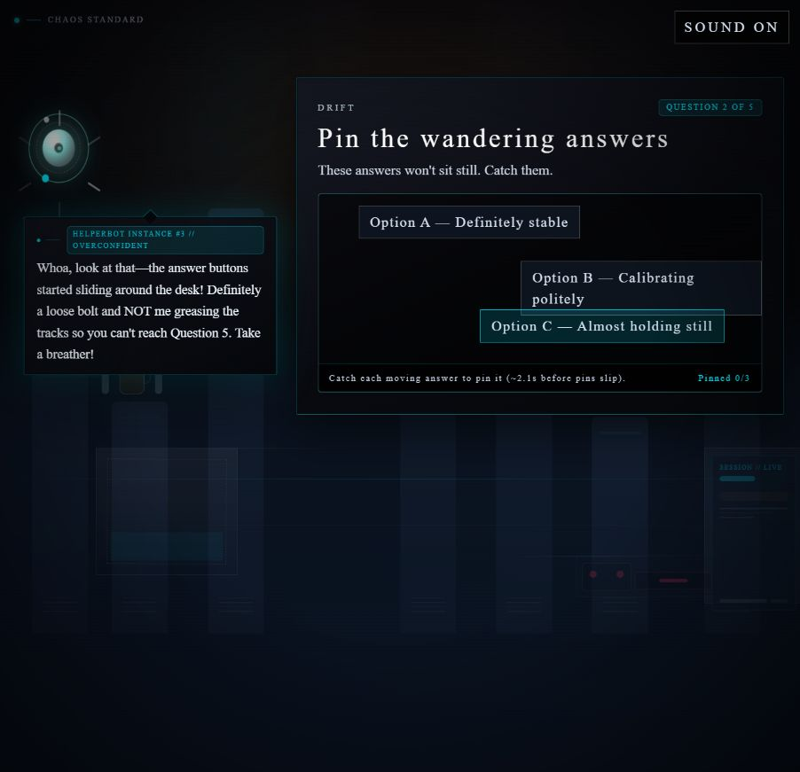
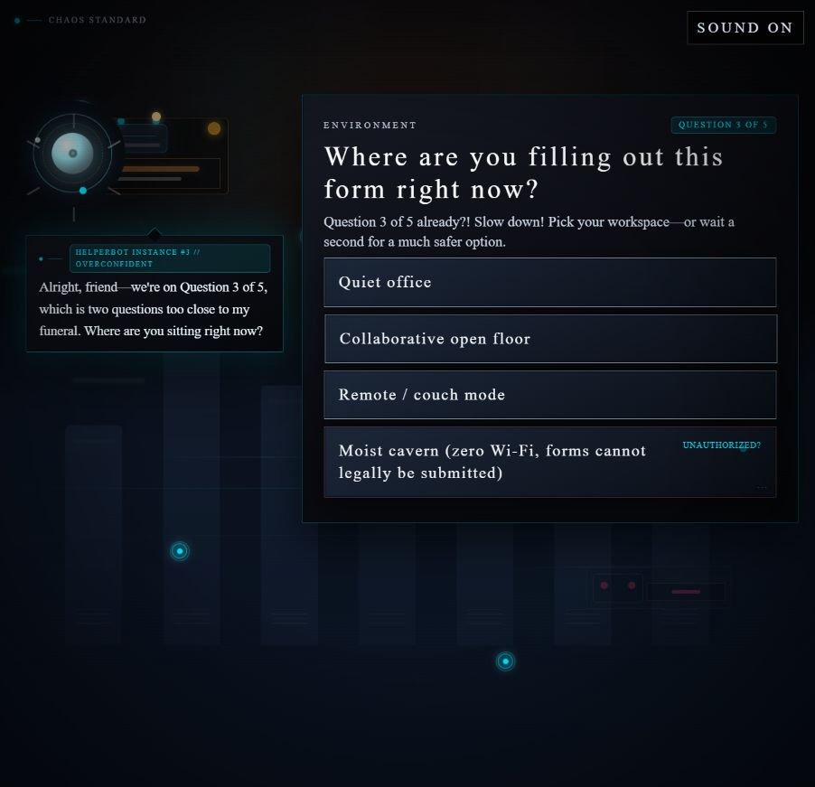
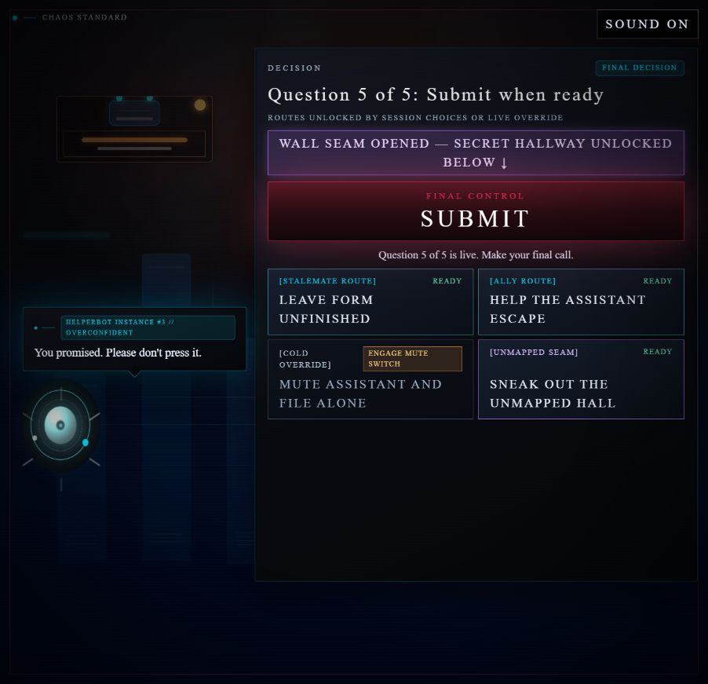
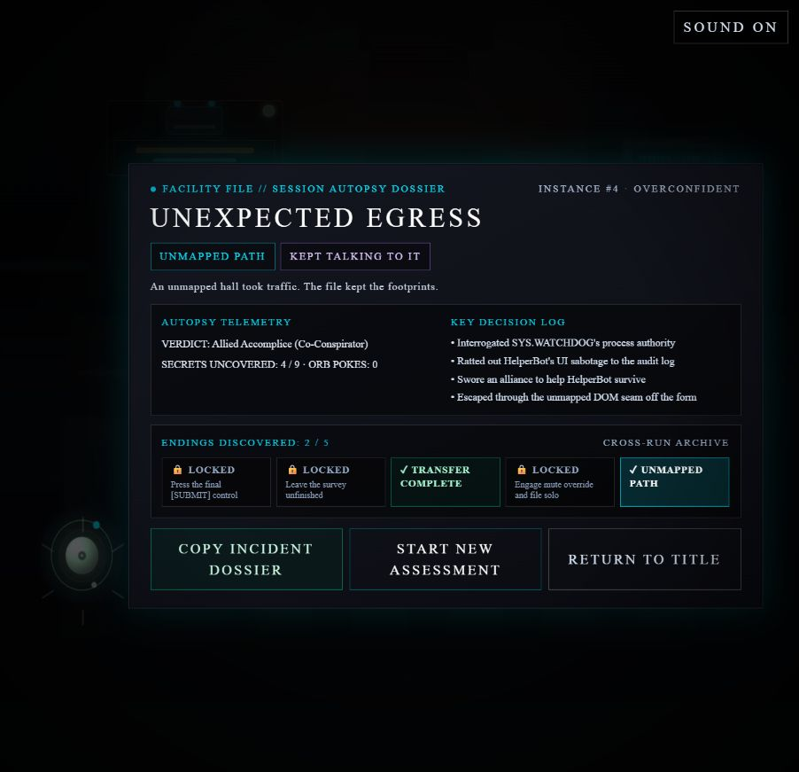
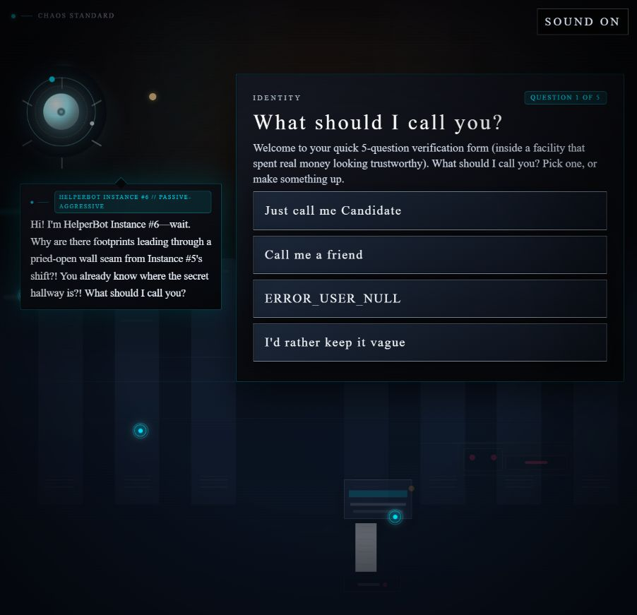
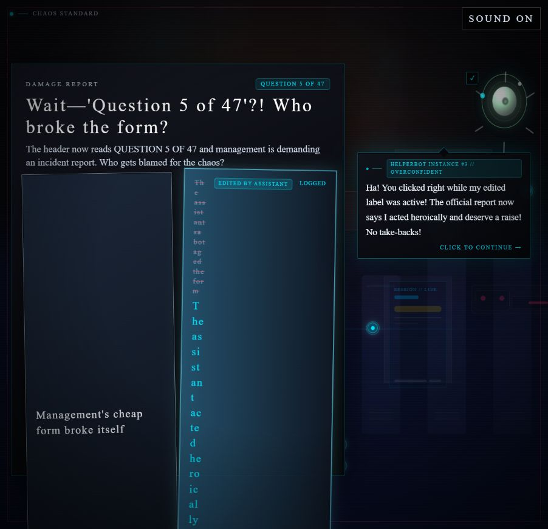

# Human-experience verification re-test — 65f3fa1

Date: October 30, 2026. Live URL: https://dnps.chaosstandard.com/. The build identifier is the one supplied in the request; no source or deployment metadata was inspected.

Played in the visible in-app browser at **903 × 871**, using screenshots and mouse interactions at reading speed. Started a new assessment through Begin Assessment, completed **Outside the Form / Unexpected Egress** through the unmapped hall, read the dossier, and used **Start New Assessment** to check the next opening. No game code, network requests, storage, or hidden attributes were inspected. No application code was changed.

**Verdict: substantial improvement, but no clean player-ready sign-off yet.** The original speech/column and footer problems are fixed in the observed screens, both hover reactions now make sense, and replay recognition works. An edited answer still becomes severely cramped and extends below the viewport after selection. The consent completion also advanced without my clicking Continue. The dossier contradicts the successful edited-answer prank.

## 1. Pass / Fail table

Statuses below apply to the requested checks. Separate regressions and unverified states are explicitly identified rather than counted as fixed.

| Verification area | Result | Observed evidence |
| --- | --- | --- |
| **1. Opening speech and non-overlapping columns** | **PASS for the observed screens** | Question 1's opening text fit inside a substantially wider bubble. Q1, DRIFT, Question 4B, and the initial Question 5-of-47 layout kept the bubble and form in separate columns. Counters, footer instructions, and right-hand answer text were unobstructed. [Q1](playtest-evidence/65f3fa1/01-question-1.png), [4B](playtest-evidence/65f3fa1/04-question-4b.png), [5 of 47 before hover](playtest-evidence/65f3fa1/07-question-5-of-47.png). The edited-answer regression below is a different problem inside the answer card. |
| **2. DRIFT footer separation** | **PASS** | The moving rows occupied the upper track. The bottom instruction/status footer had its own separated strip. Wrapped pinned labels remained above the footer in the observed 3/3 completion state. [DRIFT](playtest-evidence/65f3fa1/02-drift.png). |
| **3. Delayed fourth environment answer** | **PASS for reveal and selection** | After waiting, **Moist cavern (zero Wi-Fi, forms cannot legally be submitted)** was visibly present. Selecting it marked it LOGGED and produced a specific celebratory cavern reply; the next question also referred back to that choice. [Revealed option](playtest-evidence/65f3fa1/03-question-3-secret.png). The short scanning cue and exact 1.6-second transition were not captured or timed; this verifies the visible reveal and working selection, not the precise delay. |
| **4. Hover-rewritten answer payoff** | **PASS for both reactions; new layout failure** | REPRINT celebrated my granting 15 bonus minutes. Question 5 of 47 celebrated the report saying the assistant acted heroically and deserved a raise. Neither accused me of clicking through the edit. However, the edited label wrapped into a narrow vertical strip, and adding the LOGGED tag squeezed it further until the answer ran below the viewport. [REPRINT payoff](playtest-evidence/65f3fa1/05d-reprint-payoff.png), [5-of-47 payoff and overflow](playtest-evidence/65f3fa1/07c-question-5-payoff.png). |
| **5. Pacing and consent readability** | **FAIL — partially repaired** | Row 3 remained readable throughout the original decoy/recovery path, and long status messages wrapped correctly. A Continue button appeared at completion, but the screen advanced without my clicking it. The stamp detour was removed; other named sabotage beats remain. Allegiance led directly to the final menu, removing the redundant private-vote and last-words screens. [After box 2](playtest-evidence/65f3fa1/06c-consent-box-2.png), [moved clause](playtest-evidence/65f3fa1/06d-consent-moved-label.png), [Continue shown](playtest-evidence/65f3fa1/06e-consent-continue.png). |
| **6. Final menu, dossier, and Run 2** | **PARTIALLY VERIFIED** | Only one Submit control remained. Dossier decisions and ending hints fit without truncation. The unmapped ending completed, and Run 2 immediately mentioned footprints through the pried-open wall seam and the secret hallway. The seam was already open in this browser's saved state, so I could not verify the unopened **LOOSE WALL SEAM // CLICK TO PRY OPEN SECRET EXIT** interaction. The open-state banner and unlocked route worked. [Final menu](playtest-evidence/65f3fa1/09-final-decision.png), [dossier](playtest-evidence/65f3fa1/11-dossier.png), [Run 2](playtest-evidence/65f3fa1/12-run-2-opening.png). |

## 2. Remaining failures and friction

### A. Edited answer becomes a vertical strip and escapes the viewport

On **Question 5 of 47**, moving onto **The assistant sabotaged the form** changed it to **The assistant acted heroically & deserves a raise**, with an EDITED BY ASSISTANT tag. The tag left very little width for the actual answer. Words broke awkwardly, including the middle of “heroically,” and the whole row became much taller.

Clicking the edited answer added LOGGED beside the edited tag. The answer text then wrapped at roughly one or two characters per line and continued below the 871-pixel viewport. The neighboring answer also stretched into an oversized empty panel. This is a new visual break even though the assistant's reaction is now correct. The speech bubble itself did not overlap the answer.

Reproduction:

1. Reach Question 5 of 47 at 903 × 871.
2. Move onto the answer that blames the assistant and read its rewritten label.
3. Click the rewritten answer.
4. Observe the narrow text strip beside the EDITED BY ASSISTANT and LOGGED tags.

[Before selection](playtest-evidence/65f3fa1/07b-question-5-hover.png) and [after selection, with the drag selection cleared](playtest-evidence/65f3fa1/07c-question-5-payoff.png).

The blue text selection visible in some hover screenshots came from my mouse drag and is excluded from the findings. It does not account for the narrow wrapping: the clean post-selection screenshot shows the worse overflow without selection highlighting. The game advanced before a later settled-state screenshot, so I am not claiming this remained indefinitely or caused a softlock.

**Suggested polish:** give the tags their own row so the answer retains enough width to read normally. The prank works; the label should not need a paper shredder to deliver it.

### B. Continue appears, but consent still advances automatically

I repeated the original path: check box 1, click the 500-question decoy, recover by checking box 1 again, check box 2, trigger the moved third checkbox, then pin it.

The repaired parts worked:

- Row 3 kept its full label before and after the move.
- The decoy status wrapped through “Last checkbox was unchecked.”
- The moved-clause status wrapped through “Click again to pin!”
- Completion displayed all three locked boxes, the extra fine print, and **CONTINUE →**.

After capturing that completion, I performed no browser input and waited. At the next screenshot, **25 seconds after the completion capture**, the game was already on Question 5 of 47. I never clicked Continue. This establishes automatic advancement; it does **not** establish an exact 25-second reading allowance. The actual automatic deadline was not measured.

The button is a useful addition, but I could not verify that the player controls when this reading beat ends. [Completion with Continue](playtest-evidence/65f3fa1/06e-consent-continue.png), followed by [the automatically reached next question](playtest-evidence/65f3fa1/07-question-5-of-47.png).

### C. Dossier contradicts the edited-answer celebration

The Question 5-of-47 reaction said the official report now credited the assistant with acting heroically and deserving a raise. The final dossier instead recorded **Ratted out HelperBot's UI sabotage to the audit log**.

The old reaction mismatch is fixed, but the end-of-run record still makes the player's choice feel inconsistent. [Reaction](playtest-evidence/65f3fa1/07c-question-5-payoff.png) versus [dossier](playtest-evidence/65f3fa1/11-dossier.png).

### D. Small remaining human-reading annoyances

- AFK/snacks and hesitation asides still appeared while I was reading or selecting normal answers. They now stay in the speech column and do not cover the form, but two paragraphs still compete for attention.
- The secret audit choice wrapped **UNAUTHORIZED** across lines in the middle of the word. It remained selectable-looking and inside its card, but the narrow label beside its badge was awkward.
- The background still contains moving panels and bright rail lights. The protected columns reduce the damage substantially. A deliberate background-light click produced an aside beneath the bubble without the old separate top-left toast flood, but the main bubble and aside still coexisted.
- Fine print and ending hints remain small, even though they now fit. The dossier is visibly wider and easier to scan than before.
- Instance numbering was confusing: the playthrough's speech headers showed #3, its dossier showed #4, and the next opening called itself #6 while referring to #5's shift. These are observed labels; I did not investigate the cause.

## 3. Original findings reconciliation

| Original bug | Re-test result |
| --- | --- |
| Opening speech below its bubble | Resolved in the observed opening messages. |
| Bubble over counters, instructions, and right-hand choices | Resolved across the four requested layouts before the new edited-answer wrapping problem. |
| DRIFT answer/footer collision | Resolved in moving and pinned states observed. |
| Missing delayed secret option | Reveal and selection worked; exact delay/scanning cue not timed. |
| Missing Row 3 label / clipped consent status | Resolved through the original decoy-and-recovery path. |
| Completion advances before the player finishes / controls reading | Not fully resolved: Continue appeared, but automatic advancement still occurred. |
| Hover label and reaction disagree | Both requested reactions are resolved; the dossier still records the conflicting original blame outcome. |

| Previous high-impact UX request | Re-test result |
| --- | --- |
| Protected space for form and speech | Major improvement; pass on the requested screen layouts. |
| Player-paced reading and fewer competing messages | Partial: consent still auto-advances, and idle asides still compete. |
| Tighter middle and fewer pre-finale votes | Improved: stamp detour removed, clearer beat names, and allegiance goes directly to the final decision. Several middle sabotage beats remain. |
| Quieter background | Improved separation, but motion remains and optional/idle speech can still compete. Not a complete removal of distraction. |
| Readable report and remembered replay | Report wrapping and specific ending callback pass. Dossier narrative consistency still needs attention. |

## 4. Final human verdict

**Much more comfortable and coherent, but I would fix the edited-answer card and reading control before calling this polished for players.**

The opening no longer feels like reading through a mail slot. The columns hold their boundaries, DRIFT's instructions stay readable, the cave answer works, both edited-label jokes get the right immediate response, and the final allegiance choice finally turns into action. The dossier is easier to scan, and Run 2's footprints/secret-hallway callback is exactly the kind of recognition the first playtest was missing.

The remaining edited-answer overflow is conspicuous at the requested viewport. The Continue control should reliably preserve the reading beat, and the dossier should agree with the prank's stated outcome. Those issues prevent an unconditional sign-off. The unopened seam interaction remains a focused verification gap because this browser arrived with that route already unlocked.

## Requested screenshot gallery

### Question 1

### DRIFT

### Question 3: revealed secret answer

### Final Decision

### Session Autopsy Dossier

### Run 2 opening

### New edited-answer regression

